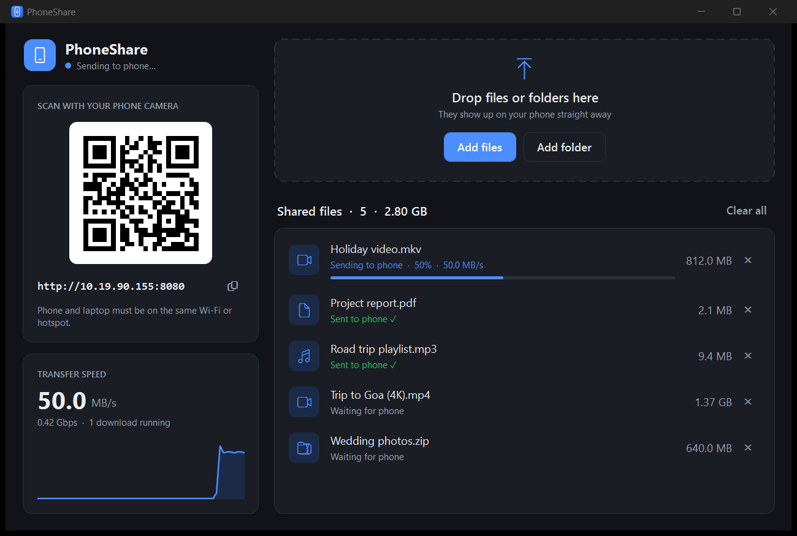
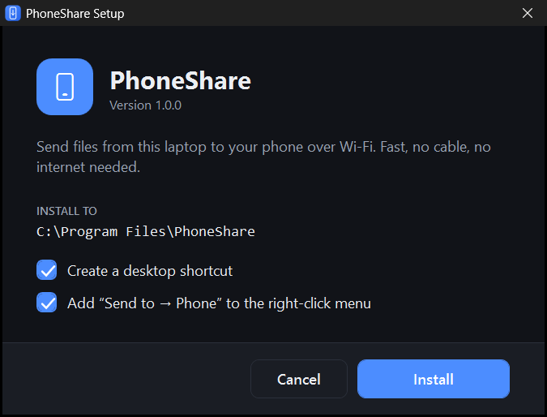

# PhoneShare

Send files from your Windows laptop to your phone over Wi‑Fi. Fast, with no cable, no app on the phone and no internet needed.



## How it works

1. Open PhoneShare on the laptop and add files: drag and drop them, click **Add files** / **Add folder**, or right‑click any file → **Send to → Phone**.
2. Scan the QR code with your phone's camera. The phone and laptop must be on the same Wi‑Fi or phone hotspot.
3. Tap **Download** on the phone.

Files go straight from the laptop to the phone over your local network. On a fast Wi‑Fi 6 connection that can reach 100+ MB/s.

## Features

- Works in any phone browser. Nothing to install on the phone.
- Connect with one scan of the QR code.
- Drag and drop files or whole folders, or use right‑click **Send to → Phone**.
- Live speed graph and per‑file progress ("Sending to phone · 64%" → "Sent to phone ✓").
- Downloads can resume. If one stops, tap it again and it continues where it left off.
- Follows the Windows light/dark setting.
- Tiny: the app is about 110 KB and uses .NET Framework 4.8, which is built into Windows 10 and 11.

## Install

1. Download **PhoneShare-Setup.exe** from the [latest release](https://github.com/G-75-Code/PhoneShare/releases/latest).
2. Run it. The installer isn't code‑signed, so Windows may show "Windows protected your PC". Click **More info → Run anyway**.

The setup:

- installs to `C:\Program Files\PhoneShare`
- adds a Windows Firewall rule so phones can connect without a popup
- adds Desktop and Start menu shortcuts, and **Send to → Phone** in the right‑click menu
- can be removed again from **Settings → Apps**



## Build from source

You only need Windows 10 or 11. The C# compiler comes with .NET Framework 4.8, so there's nothing else to install.

```powershell
powershell -ExecutionPolicy Bypass -File build.ps1
```

This creates `PhoneShare-Setup.exe` (the installer) and `build\PhoneShare.exe` (the app, which also runs without installing).

## Project layout

| Path | What it is |
| --- | --- |
| `app/` | The app: HTTP server (`Server.cs`), QR code encoder (`Qr.cs`), window (`MainWindow.xaml`, `MainWindow.cs`) and the page the phone sees (`phone.html`) |
| `setup/` | Installer and uninstaller |
| `common/` | Theme colours and shared styles |
| `tools/` | Icon generator and a QR code test helper |
| `build.ps1` | Builds everything |

## Privacy and security

- Files never leave your local network. There is no cloud service and no account.
- While PhoneShare is open, **anyone on the same Wi‑Fi** can see and download the files in its list. Use it on your own Wi‑Fi or hotspot, and close it or clear the list when you're done.
- The phone side is read‑only. Phones can't upload, delete or browse any other files.

## License

MIT. See [LICENSE](LICENSE).
